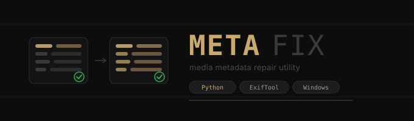

MetaFix is a desktop utility for bulk-repairing date and time metadata on photos and videos. It uses [ExifTool](https://exiftool.org/) under the hood and wraps it in a clean dark GUI built with Python, Flask, and pywebview.

Built for the common situation where photos come off a phone, cloud service, or old backup with wrong, missing, or inconsistent timestamps across their metadata fields.

---

## Features

- **Three edit modes** — set a manual date, copy one field into others, or shift dates by years/months/days/hours/minutes
- **Before/after columns** — see exactly what will change before you commit
- **Field source indicator** — the Current date column shows which EXIF field the date was read from (e.g. `2026:06:06 21:34:15 (CreateDate)`)
- **Copy source hint** — the copy mode dropdown auto-selects the most common source field across your loaded files and annotates each option with a file count
- **Filter by source field** — filter the file list to show only files whose date comes from a specific field, then select all of them with one click
- **Selection-aware actions** — preview and apply affect ticked files when any are selected; with nothing selected, they affect all loaded files
- **Drag and drop** — drop files or folders directly onto the window
- **Recursive folder scan** — optional, toggled per session
- **Rename to timestamp** — renames files to `YYYY-MM-DD_HH-MM-SS_originalname.ext` after writing metadata, with `(1)`, `(2)` duplicate protection
- **BACKUPS folder** — verified originals are copied before writes directly into a flat `BACKUPS/` folder, retaining their filenames; repeat backups use `(1)`, `(2)`, etc.
- **Undo** - restores the exact backups from the last modified batch, including original filenames; failed restores remain retryable
- **Clean backups** - previews and confirms deletion of owned backups only; unrelated and untracked legacy backups remain untouched
- **Build version** - shown beneath the MetaFix name in muted text; source runs show `v0.0.0+dev`
- **ExifTool path memory** — set once, remembered in `data/config.json` forever
- **No re-encoding** - ExifTool edits metadata; AVI uses FFmpeg stream copy, with verified originals retained for recovery
- **Silent background tools** - metadata reads and writes do not open Windows terminal windows

---

## Supported formats

| Type | Extensions |
|------|-----------|
| Photos | `.jpg` `.jpeg` `.png` `.heic` `.webp` `.tiff` |
| Videos | `.mov` `.mp4` `.m4v` `.avi` `.mkv` `.3gp` `.gif` |

---

## Requirements

- **Windows 10/11**, **macOS Apple Silicon**, or a compatible **Linux x64 desktop**. Windows is the established runtime; native media editing on macOS/Linux still needs verification.
- **Python 3.10+** for source runs; release builds use Python 3.12. Packaged downloads do not require a separate Python installation.
- **ExifTool**, supplied separately, for metadata reads and writes.
- **FFmpeg and ffprobe**, supplied separately, for AVI support.
- A writable app location for saved tool paths in `data/config.json`.

---

## Installation

```bash
git clone https://github.com/TariqMK/MetaFix.git
cd MetaFix
pip install -r requirements.txt
python MetaFix.py
```

On first launch, click the ExifTool path bar and select its executable. For AVI files, also set FFmpeg and make ffprobe available. Paths are saved in `data/config.json`; the directory and file are created when you first save a tool path. Keep the app in a writable location. The pickers currently prefer `.exe` files; use All files on other platforms.

---

## Builds and releases

In GitHub, open **Actions > Build and release > Run workflow**. Choose the
branch, then select both inputs before starting. This workflow runs manually only:

- **Visibility:** `draft` (default) or `public` (published GitHub release).
- **Bump:** `major`, `minor`, or `patch` (default).

The workflow builds Windows x64, macOS Apple Silicon ARM64 (no Intel build), and
Linux x64 archives using native runners. All three builds must succeed before
any release is created. The workflow must be on the default branch for the Run
workflow button to appear. No additional secrets are required; the workflow uses
GitHub's built-in token with release-write permissions in the relevant jobs.

Version numbers come from the highest semantic version across **all paginated
release records (including drafts) and Git tags**, rather than only the latest
published release. With no version history, the starting point is `0.0.0`.
For example, if `v1.2.3` is public and `v1.3.0` is a draft, patch produces
`v1.3.1`, minor produces `v1.4.0`, and major produces `v2.0.0`.
Prerelease tags also reserve their base version. Unrelated tag names are ignored.

Releases are tagged `vMAJOR.MINOR.PATCH` at the exact commit that was built.
The allocated version is embedded in each build and available as
`metafix.__version__` and displayed beneath the MetaFix name in muted text; source checkouts report `0.0.0+dev`. The workflow does not
commit version changes back to your branch. Tags and release records are the
persistent version history, including drafts. Workflows run serially to avoid
allocating duplicate versions.

Each release starts as a draft, receives all three archives, and is published
only if `public` was selected. An upload failure leaves a draft for inspection.
Rerunning the same workflow reuses its release version and verifies the tag's
commit. Matching uploaded assets are skipped; missing assets are uploaded.
Published assets are never replaced. A new workflow run counts the existing
version and advances again. To publish an existing draft
without incrementing, use **Releases > Edit > Publish release** instead.

Build downloads are ZIP files for Windows and macOS, and a tar.gz file for Linux.
Extract the archive before running it. ExifTool and FFmpeg are external tools and
are not bundled. Windows filesystem creation-time updates require Windows.
The macOS app is unsigned and not notarized; Linux builds target Ubuntu 22.04 or
compatible newer desktop distributions and require system desktop libraries.
The cross-platform builds were reported working after the asset-path fix. Native GUI and media editing still require end-to-end testing on each OS.

For a local build, use Python 3.12 and run:

```bash
python -m pip install -r packaging/requirements.txt
python scripts/build.py --version 1.0.0
```

After packaging, the build script runs the actual executable in headless
`--smoke-test` mode, checking Flask resources, the Qt backend import, and the
embedded version before archiving. This is not an interactive GUI/media test.

The tracked build script packages the current package layout. The legacy spec
in ignored `Meta/` is unchanged and is not used by this workflow.

## Usage

### 1 — Load files

Drag and drop photos or videos directly onto the window, or use the **add files** and **add folder** buttons in the toolbar. Enable **Recursive folders** before adding a folder to scan all subfolders.

Files appear in the table with their current metadata date and the field it was read from. The priority order for field selection is:

```
DateTimeOriginal → ContentCreateDate → CreateDate → MediaCreateDate
→ TrackCreateDate → TrackModifyDate → ModifyDate → FileCreateDate → FileModifyDate
```

### 2 — Choose a mode

**Manual** — Pick a specific date and time. That exact value will be written to all selected destination fields. Use this when you know the correct date (e.g. you scanned old photos and want to tag them with the day they were taken).

**Copy** — Copies the value from one source field into all selected destination fields on the same file. Useful when one field has the correct date and the others don't. The dropdown auto-selects the most common source field across your loaded files and shows the count per field so you can confirm you're picking the right one.

**Shift** — Moves every date forward or backward by a relative offset. Enter negative values to go backwards. Useful for correcting timezone errors (e.g. camera was set to the wrong timezone) or systematic clock drift.

### 3 — Select files

When any files are checked, preview and apply use that selection. **With nothing checked, both operate on all loaded files**, even if a source filter is active. Check individual rows or use the header checkbox to select all visible rows. The toolbar shows a **gold pill** with the current selection count.

Use the **filter by source field** dropdown to narrow the table to files that share a particular source field. A **select all filtered** button appears when a filter is active, letting you select exactly that subset in one click.

### 4 — Select destination fields

The sidebar shows all writable EXIF/metadata fields. All are ticked by default. Untick any you don't want written.

| Field | Used by |
|-------|---------|
| `DateTimeOriginal` | Most photo apps, Lightroom, Immich, Google Photos |
| `CreateDate` | Photos and videos broadly |
| `ModifyDate` | General modification timestamp |
| `MediaCreateDate` | QuickTime/MP4 video containers |
| `TrackCreateDate` | Individual tracks within video files |
| `TrackModifyDate` | Track-level modification time |

**Update filesystem date** writes `FileModifyDate` in addition, which affects what Windows Explorer shows in the "Date modified" column.

### 5 — Preview

Click **⊙ preview** to populate the After column without writing anything. The After column highlights in gold where the value will change, and stays dim where it won't. When a selection is active, preview covers only selected files. Changing the inputs or selection clears the old preview. Preview and apply share the same source-date calculation, including AVI files. An invalid date or missing source prevents the batch from starting.

### 6 — Apply

Click **▶ apply changes**. The status bar shows exactly how many files were processed and reports any errors inline. MetaFix creates a verified backup before each write. Controls are disabled while the batch runs, and conflicting backend requests are rejected. Rename is attempted only after a successful write. Timestamp and rename failures are reported separately from metadata-write success.

### 7 — Undo and cleanup

**Undo last** restores the exact backups from the last batch that modified files.
It restores original filenames after renaming, refuses to overwrite another file
at the old name, and checks that the modified file and backup contents have not
changed. Failed restores remain available for retry. Undo history is in memory
and does not survive restarting the app.

**Clean backups** first displays the exact list of tracked backups for confirmation.
It deletes only verified MetaFix-owned backup files in the relevant directories.
Unrelated contents and old untracked backups are left alone. New backups created
since the preview require a fresh confirmation.

---

## Windows filesystem dates

The **Update Windows creation date (PowerShell)** option sets filesystem
CreationTime and LastWriteTime after successful metadata writes. This is
separate from embedded fields such as `DateTimeOriginal`. It requires Windows
and PowerShell; leave it disabled on macOS/Linux. PowerShell failures are
reported in the per-file results, and the metadata change remains undoable.

**Update filesystem date** controls ExifTool's `FileModifyDate` write for
non-AVI files. The PowerShell option also sets LastWriteTime independently.

---

## File safety

ExifTool updates metadata; AVI files are remuxed with FFmpeg stream copy,
without re-encoding. Metadata edits change file bytes, and AVI remuxing can change
container structure. No tool can promise zero corruption for every input, and
MetaFix does not currently compare decoded images or encoded media streams after
editing. Original files are retained in `BACKUPS/`.

The flat `BACKUPS/` folder contains only backup media files. Tracking records
under the app's `data/backup-records/` identify the original, resulting filename,
and exact backup. Keep `data/backup-records/` if you want tracked cleanup to
remain available after restarting. The backup media can be restored manually
without these records. Content hashes protect against restoring a changed backup or
overwriting a file edited after apply. Keep backups until you have checked the
results. Cleanup never recursively deletes the shared `BACKUPS/` folder.

Existing nested backups from older versions remain usable for tracked cleanup;
they are not moved automatically. Old backups made before ownership tracking
are not adopted or deleted automatically. Inspect those originals manually before removing them.

---

## Project structure

```text
MetaFix/
|-- MetaFix.py                  Desktop launcher
|-- metafix/
|   |-- __init__.py             Flask factory and build version
|   |-- desktop.py              Window, server, drag-and-drop
|   |-- routes.py               HTTP endpoints and file dialogs
|   |-- config.py               Configuration and session state
|   |-- fields.py               Supported formats and fields
|   |-- dates.py                Date shifts and Windows timestamps
|   |-- metadata.py             Metadata reads and source selection
|   |-- exiftool.py             ExifTool adapter
|   |-- ffmpeg.py               AVI adapter
|   |-- operations.py           Preview, apply, undo, cleanup
|   |-- backups.py              Flat backup creation and recovery
|   |-- processes.py            Silent background tools
|   |-- session.py              Operation serialization
|   |-- files.py                File collection and renaming
|   |-- templates/index.html    Interface markup
|   `-- static/
|       |-- css/app.css         Styles
|       `-- js/app.js           Interface logic
|-- .github/workflows/release.yml
|-- scripts/                    Build, versioning, smoke checks
|-- tests/                      Safety, UI, release, version, build checks
|-- packaging/requirements.txt  Release build dependencies
|-- docs/assets/banner.svg      README banner
|-- data/                       Generated app data (ignored)
|   |-- config.json             Saved executable paths
|   `-- backup-records/         Ownership and integrity records
|-- requirements.txt            Source runtime dependencies
`-- README.md
```

The interface calls Flask routes, which delegate batch work to `operations.py`.
Metadata adapters run ExifTool or FFmpeg; native window integration lives in
`desktop.py`. Flask resolves templates and static assets relative to the package.

`data/config.json` is stored relative to the app directory, independently of the
working directory. In a packaged build, it lives beside the executable in `data/` (inside
`MetaFix.app/Contents/MacOS/` on macOS).
The directory is created automatically when settings are saved and is ignored by Git.
Loaded files and the last batch remain in memory.

Ignored `Meta/` holds local handover notes and legacy files. `venv/` and
`MetaFix.bat` are local environment/launcher files. Generated build output and
Python caches are ignored too.

---

## Tech stack

| Component | Library |
|-----------|---------|
| GUI shell | [pywebview](https://pywebview.flowrl.com/) (Qt backend) |
| Web server | [Flask](https://flask.palletsprojects.com/) |
| Metadata | [ExifTool](https://exiftool.org/) (subprocess) |
| Date maths | [python-dateutil](https://dateutil.readthedocs.io/) |
| Packaging | [PyInstaller](https://pyinstaller.org/) |
| UI fonts | Inter + IBM Plex Mono |

---

## Dependencies

```
flask
pywebview[qt]
python-dateutil
```

Install with:

```bash
pip install -r requirements.txt
```


## Development checks

```bash
node --test tests/*.test.cjs
python -m unittest discover -s tests -p "test_*.py"
python scripts/check_app.py
```

Current regression suite: **34 Python tests and 20 Node tests (54 total)**.
The Python safety tests use temporary dummy files and mocked external tools.
Local real-tool checks also passed for generated JPEG, MP4, and AVI samples: write,
read-back, copy preview, rename, and byte-exact undo. Additional real JPEG/AVI
checks passed with flat backups, hidden subprocesses, and Windows timestamp updates.
JavaScript tests cover version allocation, release retries, and UI state/error
recovery. The build-path tests mock native packaging commands; source smoke
checks exercise imports and Flask routes without opening a window or modifying
media. GitHub Actions additionally runs the packaged executable's smoke mode.
These latest packaged checks still need a fresh native workflow run.

Batch progress is currently an activity indicator,
not a measured per-file completion percentage. Recursive scanning works through
**add folder**; native folder drag-and-drop scans only the immediate directory.

Timestamp policy: naive input dates are local wall-clock times. Offset-aware
source dates are converted to local time before editing; fractional seconds are
accepted and edits use whole seconds. ExifTool reads and writes use
`QuickTimeUTC=1` so integer QuickTime fields convert consistently. Calendar shifts
operate on local wall-clock time, with conversion at the target date. The manual
datetime picker starts at the current local time, not UTC.

The desktop server binds an available loopback port before the window opens,
so separate app instances do not share a fixed port or file selection.

Background ExifTool, FFmpeg, ffprobe, and PowerShell processes run without
opening terminal windows on Windows. Output and errors are still captured for
the app's status messages.
