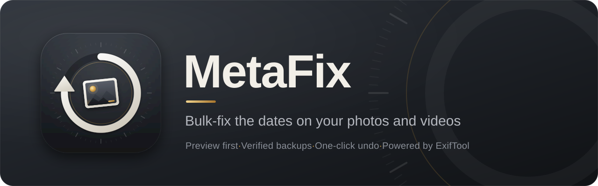
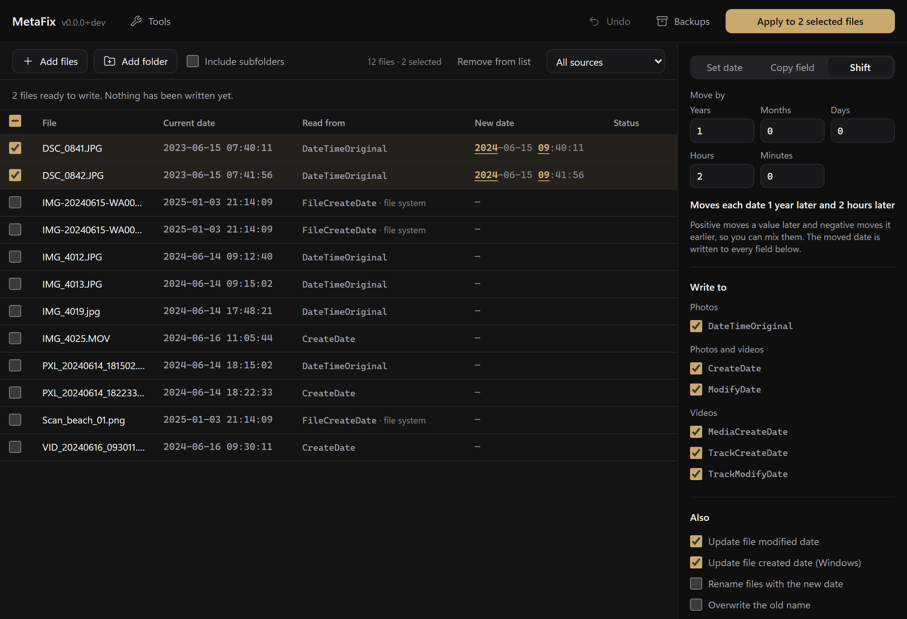
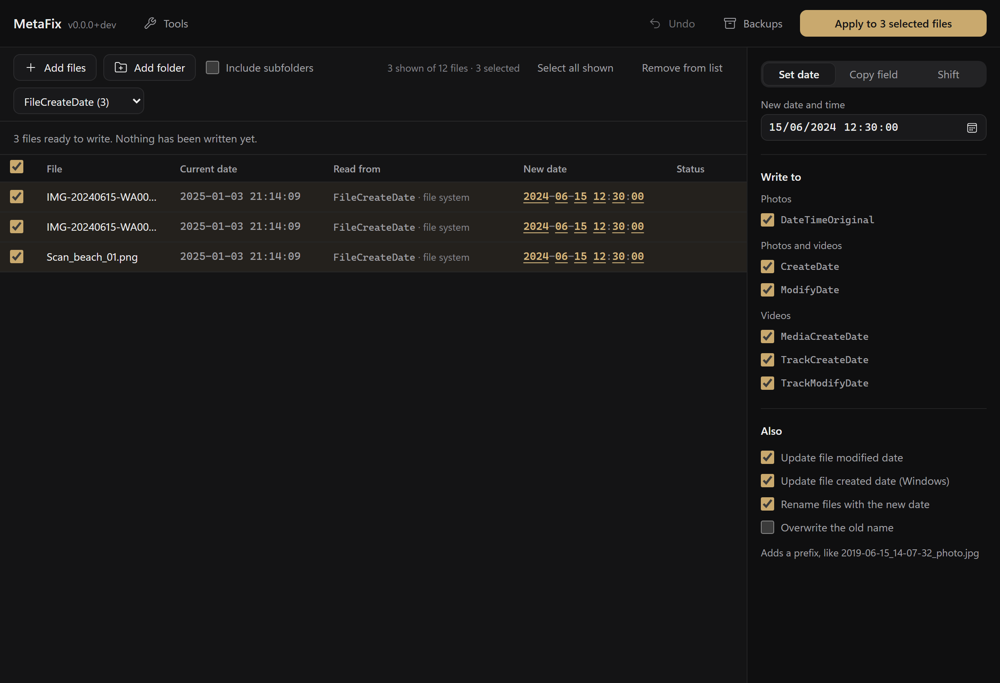
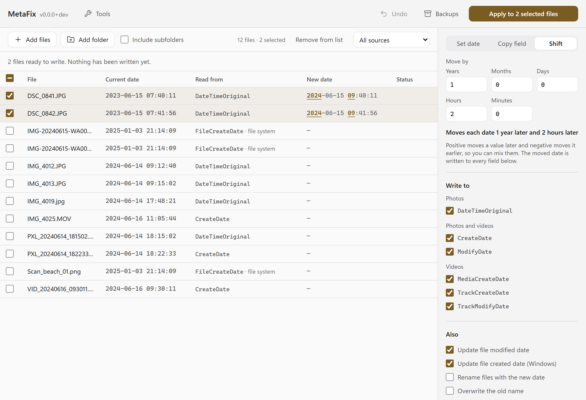
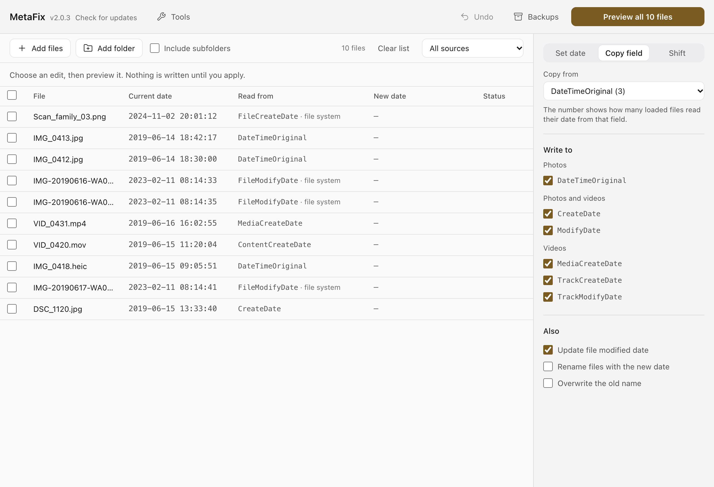
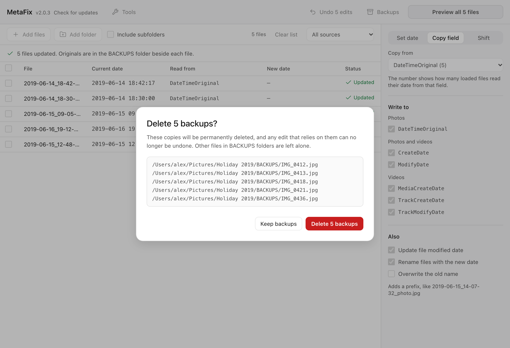
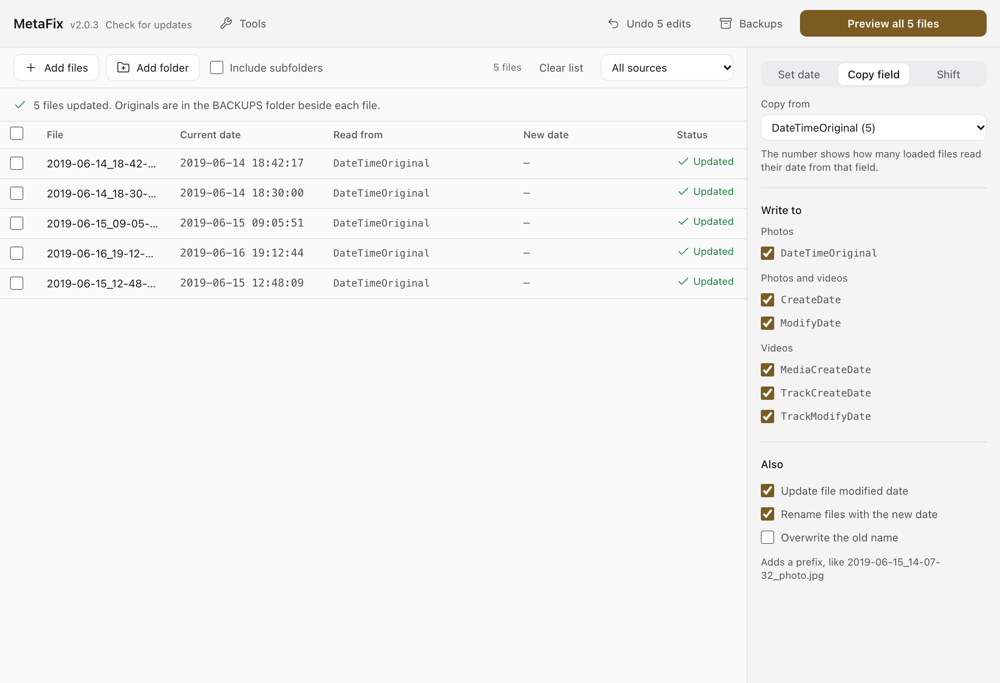
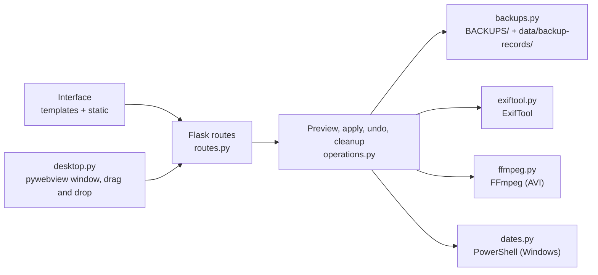

MetaFix corrects wrong or missing dates on hundreds of photos and videos at once. Works offline. Sends no data.

**Contents:** [What it does](#what-it-does) · [Privacy](#privacy) · [Download](#download) · [How to use](#how-to-use) · [For developers](#for-developers)



## What it does

Photos and videos from a phone, a cloud service or an old backup often have wrong, missing or mixed-up dates. Your photo library then puts them in the wrong place. MetaFix writes the correct date into each file, so every photo lands in the right month.

### Fix dates three ways



- **Set date** writes one exact date and time to every file you choose.
- **Copy field** copies a correct date from one field in each file into its other date fields.
- **Shift** moves each date by years, months, days, hours and minutes. You can mix directions, for example 1 day later and 2 hours earlier.

### See every change before it is written



The main button always previews first. The current and new dates show side by side, and only the parts that change are highlighted. Then the button names exactly which files it will change.

### Know where each date came from

<picture>
  <source media="(prefers-color-scheme: dark)" srcset="docs/assets/screenshots/read-from-dark.png">
  
</picture>

The **Read from** column shows which field each date was read from. Dates that exist only on the file system are flagged. Filter by a field to show and select exactly those files.

### Every original is kept

<picture>
  <source media="(prefers-color-scheme: dark)" srcset="docs/assets/screenshots/backups-dark.png">
  
</picture>

Before each change, MetaFix copies the original file into a `BACKUPS` folder beside it, with its original name. **Undo** puts back the last batch, with the original filenames and, on Windows, the original created dates.

### Rename files by date

<picture>
  <source media="(prefers-color-scheme: dark)" srcset="docs/assets/screenshots/rename-applied-dark.png">
  
</picture>

MetaFix can rename each file to start with its new date, for example `2019-06-14_18-30-00_photo.jpg`. Files that share a date get `(1)`, `(2)`.

### More

- Drag files or folders onto the window.
- MetaFix follows your system's light or dark appearance.
- Images and video are not re-encoded. MetaFix changes only the date information.
- Windows only: MetaFix can also set the **Date created** and **Date modified** that File Explorer shows.
- Background tools do not open terminal windows on Windows.
- MetaFix remembers where ExifTool and FFmpeg are, so you set them once.

## Privacy

- MetaFix works offline. All editing happens on your computer.
- Your files never leave your computer.
- No accounts, no tracking, no analytics, no crash reports.
- Settings are kept in a `data` folder beside the app. Backup records are kept in `data/backup-records/`. Move the app, and its settings move with it.
- MetaFix connects to the internet in one case only. When you select **Check for updates**, it asks GitHub (api.github.com) for the latest version number. It sends only the app name, `MetaFix`. It sends nothing about you or your files, and keeps nothing.
- If a newer version exists, selecting it opens the GitHub release page in your browser. MetaFix downloads nothing itself.

## Download

MetaFix runs on:

- Windows 10 or 11 (x64). This is the most tested version.
- macOS on Apple Silicon Macs. There is no version for Intel Macs.
- Linux x64: Ubuntu 22.04, or a compatible newer desktop. It needs the standard system desktop libraries.

**Note:** The macOS and Linux versions still need more testing with real photo and video edits.

1. Open the [latest release](https://github.com/TariqMK/MetaFix/releases/latest).
2. Download the file for your computer:
   - Windows: `MetaFix-v<version>-windows-x64.zip`
   - macOS: `MetaFix-v<version>-macos-arm64.zip`
   - Linux: `MetaFix-v<version>-linux-x64.tar.gz`
3. Extract the download into a folder you can write to. MetaFix saves its settings in that folder.
4. Open `MetaFix.exe` (Windows), `MetaFix.app` (macOS) or `MetaFix` (Linux).

### You also need ExifTool

MetaFix uses ExifTool, a free tool, to read and write dates. It is not included.

1. Download ExifTool from [exiftool.org](https://exiftool.org/).
2. Open MetaFix and select **Choose ExifTool**.
3. Select the ExifTool program file. MetaFix remembers it.

For AVI videos you also need FFmpeg and ffprobe, also free:

1. Download FFmpeg from [ffmpeg.org](https://ffmpeg.org/). It includes ffprobe.
2. In MetaFix, select **Tools**, then select the FFmpeg program file.
3. Keep ffprobe in the same folder as FFmpeg.

**Note:** The file picker looks for `.exe` files first. On macOS and Linux, choose **All files** in the picker to see the program.

### Opening on macOS

MetaFix isn't notarised by Apple, so macOS shows a warning the first time you open it. This is expected and doesn't mean the app is harmful.

1. Open MetaFix and click **Done** on the warning.
2. Open **System Settings → Privacy & Security**, scroll down to the message saying "MetaFix" was blocked, and click **Open Anyway**.
3. Enter your password, then click **Open** on the next prompt. You only need to do this once.

<details>
<summary>If you use Terminal</summary>

You can run this instead:

    xattr -dr com.apple.quarantine "/Applications/MetaFix.app"

</details>

### Supported files

| Type | File types |
|------|-----------|
| Photos | `.jpg` `.jpeg` `.png` `.heic` `.webp` `.tiff` |
| Videos | `.mov` `.mp4` `.m4v` `.avi` `.mkv` `.3gp` `.gif` |

## How to use

### 1. Add files

1. Drag photos, videos or folders onto the window. Or select **Add files** or **Add folder**.
2. To include the folders inside a folder, tick **Include subfolders** before you select **Add folder**.

**Note:** A folder that you drag onto the window adds only the files directly inside it. Use **Add folder** to include subfolders.

Each file shows its current date in **Current date**, and the field it came from in **Read from**. MetaFix reads the first date it finds, in this order:

```
DateTimeOriginal → ContentCreateDate → CreateDate → MediaCreateDate
→ TrackCreateDate → TrackModifyDate → ModifyDate → FileCreateDate → FileModifyDate
```

`FileCreateDate` and `FileModifyDate` come from the file system, not from the photo or video itself.

### 2. Choose a mode

- **Set date.** Pick one date and time. MetaFix writes it to every file. Use it when you know the correct date, for example for scanned photos. The picker starts at the current local time.
- **Copy field.** Pick the field to copy from in **Copy from**. MetaFix copies that date into the other fields of the same file. Use it when one field has the correct date. The list picks the most common field in your files and shows how many files have each field.
- **Shift.** Enter values under **Move by**. Positive values move dates later. Negative values move them earlier. You can mix them: `1` day with `-2` hours moves a date 1 day later and 2 hours earlier. The sentence under the values confirms the result. Use it for a camera clock or time zone that was set wrong.

### 3. Choose the files

- To change some files only, tick them. Select a row or its checkbox. The header checkbox ticks every row shown.
- With nothing ticked, MetaFix changes **all** loaded files, even files hidden by a filter. The main button says "all", and the summary line counts any hidden files.
- To show only files whose date comes from one field, choose it in the **All sources** list. Then select **Select all shown** to tick exactly those files.

The toolbar shows how many files are ticked.

### 4. Choose the fields to write

The **Write to** list shows every date field MetaFix can write. All are ticked. Untick any field you want to leave alone.

| Field | Used by |
|-------|---------|
| `DateTimeOriginal` | Most photo apps, Lightroom, Immich, Google Photos |
| `CreateDate` | Photos and videos in general |
| `ModifyDate` | General last-changed date |
| `MediaCreateDate` | MOV and MP4 videos |
| `TrackCreateDate` | The separate tracks inside a video |
| `TrackModifyDate` | Last-changed date of each track |

Under **Also**:

- **Update file modified date** also writes `FileModifyDate`. This is the **Date modified** that File Explorer shows.
- **Update file created date (Windows)** also sets the **Date created** and **Date modified** that File Explorer shows. It shows on Windows only.
- **Rename files with the new date** renames each file to start with its new date, for example `2019-06-15_14-07-32_photo.jpg`. Files that share a date get `(1)`, `(2)`.
- **Overwrite the old name** works only with **Rename files with the new date**. The name becomes only the date, for example `2019-06-15_14-07-32.jpg`. **Undo** still puts back the original name.

### 5. Preview

1. Select the main button at the top right. It says **Preview** and names the files it covers.
2. Read the **New date** column. Only the parts of a date that will change are highlighted.

Nothing is written yet. "Same date" means the date shown already matches, but other fields can still be written. If a date is not valid or a file has no date to read, the batch does not start, and the row shows the reason. If you change a setting or the ticked files, the old preview clears and you must preview again.

### 6. Apply

1. Check the main button. It now says **Apply to** and names the files it will change.
2. Select it to write the new dates.

**Note:** The button stays locked for 1 second after a preview, so a double-click cannot write by mistake.

The summary line above the table shows how many files were changed. Errors show in their rows. MetaFix copies and checks a backup of each file before it changes it. Files are renamed only after their dates are written. A failed rename or created-date change shows separately from the date change.

### 7. Undo and backups

**Undo** puts back the files from the last batch that changed files:

- It puts back the original filenames, and on Windows the original created dates.
- It does not replace another file that now has the old name.
- It does not restore a file or backup that was changed after the batch.
- If a file cannot be put back, you can select **Undo** again to retry.

**Caution:** Undo remembers only the last batch, and only until you close MetaFix.

**Backups** shows the list of backups MetaFix made, and asks before it deletes them. **Keep backups** is the default.

**Caution:** If you delete the backups of the last batch, you can no longer undo it.

- MetaFix deletes only backups it made and checked. Other files in a `BACKUPS` folder stay.
- Backups made by versions before backup tracking are never deleted. Check them and delete them yourself.

### Keep your files safe

- Keep the `BACKUPS` folders until you have checked the results.
- Each `BACKUPS` folder sits beside your files. It holds only copies of your original files, with their original names. A second backup of the same name gets `(1)`, `(2)`.
- MetaFix keeps a record of each backup in the app's `data/backup-records/` folder. Keep that folder, so **Backups** can still find them after you restart MetaFix.
- To put back a file by hand, copy it out of `BACKUPS`. This does not reset its Windows created date.
- MetaFix changes only date information. AVI videos are rewritten with FFmpeg without re-encoding the video. No tool can promise that every file stays perfect, and MetaFix does not compare the pictures or video after editing.

### Check for updates

1. Select **Check for updates** beside the version number, next to the MetaFix name.
2. If a newer version exists, it shows in gold. Select it to open the release page in your browser.

## For developers

Building the app yourself or changing it? Everything you need is below.

<details>
<summary><strong>Run from source</strong></summary>

You need Python 3.10 or later. Release builds use Python 3.12.

```bash
git clone https://github.com/TariqMK/MetaFix.git
cd MetaFix
pip install -r requirements.txt
python MetaFix.py
```

Runtime dependencies (`requirements.txt`): `flask`, `pywebview[qt]`, `python-dateutil`.

A source run shows the version `v0.0.0+dev`.

</details>

<details>
<summary><strong>Run the tests</strong></summary>

```bash
node --test tests/*.test.cjs
python -m unittest discover -s tests -p "test_*.py"
python scripts/check_app.py
```

Current suite: 44 Python tests and 31 Node tests (75 total).

- The Python safety tests use temporary dummy files and mocked external tools.
- The JavaScript tests cover version allocation, release retries, and UI state and error recovery.
- The build-path tests mock native packaging commands.
- `check_app.py` checks imports and Flask routes without opening a window or changing media.
- GitHub Actions also runs the packaged app's smoke mode.

Manual checks so far:

- Real-tool checks passed for generated JPEG, MP4 and AVI samples: write, read-back, copy preview, rename and byte-exact undo.
- Real JPEG and AVI checks passed with flat backups, hidden subprocesses and Windows timestamp updates.
- The interface passed in a browser with real ExifTool on JPEG and PNG copies: preview, mixed-direction shift, rename and byte-exact undo. Undo's created-date restore passed with and without renaming.
- The interface has not yet been checked in the native desktop window.
- The latest packaged checks still need a fresh native workflow run.

</details>

<details>
<summary><strong>How it works</strong></summary>



The interface calls Flask routes, which pass batch work to `operations.py`. Metadata adapters run ExifTool or FFmpeg. Native window integration lives in `desktop.py`. Flask finds templates and static files relative to the package.

**Project structure**

```text
MetaFix/
|-- MetaFix.py                  Desktop launcher
|-- metafix/
|   |-- __init__.py             Flask factory and build version
|   |-- desktop.py              Window, server, drag-and-drop
|   |-- routes.py               HTTP endpoints and file dialogs
|   |-- updates.py              Manual update check
|   |-- config.py               Configuration and session state
|   |-- fields.py               Supported formats and fields
|   |-- dates.py                Date shifts and Windows timestamps
|   |-- metadata.py             Metadata reads and source selection
|   |-- exiftool.py             ExifTool adapter
|   |-- ffmpeg.py               AVI adapter
|   |-- operations.py           Preview, apply, undo, cleanup
|   |-- backups.py              Flat backup creation and recovery
|   |-- processes.py            Silent background tools
|   |-- session.py              Operation serialization
|   |-- files.py                File collection and renaming
|   |-- templates/index.html    Interface markup
|   `-- static/
|       |-- css/app.css         Styles
|       `-- js/app.js           Interface logic
|-- .github/workflows/release.yml
|-- scripts/                    Build, versioning, smoke checks
|-- tests/                      Safety, UI, release, version, build checks
|-- packaging/requirements.txt  Release build dependencies
|-- docs/                       GitHub Pages product page
|   `-- assets/                 README banner, screenshots and app icons (SVG masters)
|-- data/                       Generated app data (ignored)
|   |-- config.json             Saved executable paths
|   `-- backup-records/         Ownership and integrity records
|-- requirements.txt            Source runtime dependencies
`-- README.md
```

**Tech stack**

| Component | Library |
|-----------|---------|
| GUI shell | [pywebview](https://pywebview.flowrl.com/) (Qt backend) |
| Web server | [Flask](https://flask.palletsprojects.com/) |
| Metadata | [ExifTool](https://exiftool.org/) (subprocess) |
| AVI dates | [FFmpeg](https://ffmpeg.org/) stream copy (subprocess) |
| Date maths | [python-dateutil](https://dateutil.readthedocs.io/) |
| Packaging | [PyInstaller](https://pyinstaller.org/) |
| UI fonts | System UI and monospace fonts (no network needed) |

**App data**

- `data/config.json` is stored relative to the app folder, not the working directory. In a packaged build it lives beside the executable in `data/` (inside `MetaFix.app/Contents/MacOS/` on macOS).
- The `data/` folder is created when settings are first saved, and is ignored by Git.
- Loaded files and the last batch stay in memory only.
- Ignored `Meta/` holds local handover notes and legacy files. `venv/` and `MetaFix.bat` are local environment and launcher files. Build output and Python caches are ignored too.

**Backups**

- Tracking records in `data/backup-records/` identify the original, the resulting filename and the exact backup.
- Content hashes protect against restoring a changed backup or overwriting a file edited after apply.
- Cleanup never recursively deletes the shared `BACKUPS/` folder.
- Nested backups from older versions stay usable for tracked cleanup. They are not moved. Untracked backups from before ownership tracking are never adopted or deleted.

**Timestamp policy**

- Naive input dates are local wall-clock times.
- Offset-aware source dates are converted to local time before editing. Fractional seconds are accepted; edits use whole seconds.
- ExifTool reads and writes use `QuickTimeUTC=1`, so integer QuickTime fields convert consistently.
- Calendar shifts operate on local wall-clock time, with conversion at the target date.

**Windows file dates**

- **Update file created date (Windows)** uses PowerShell to set `CreationTime` and `LastWriteTime` after a successful metadata write. It is hidden and off on macOS and Linux.
- PowerShell failures are reported per file. The metadata change stays undoable.
- **Update file modified date** controls ExifTool's `FileModifyDate` write for non-AVI files.

**Other notes**

- The desktop server binds a free loopback port before the window opens, so separate app instances do not share a port or file selection.
- ExifTool, FFmpeg, ffprobe and PowerShell run without opening terminal windows on Windows. Their output and errors are still captured for status messages.
- Batch progress is an activity indicator, not a per-file percentage.
- Preview and apply share the same source-date calculation, including AVI files.
- Controls are disabled while a batch runs, and conflicting backend requests are rejected.
- The required preview is enforced in the interface only. The backend does not check for a preview.

</details>

<details>
<summary><strong>Update the screenshots</strong></summary>

`docs/assets/make_screenshots.py` retakes the read-from, rename-applied and backups screenshots in dark and light. It runs the real interface with made-up sample files and a stand-in for ExifTool, so no real files or settings are used.

```bash
uv run --with playwright playwright install chromium
uv run --python 3.12 --with flask --with python-dateutil --with playwright python docs/assets/make_screenshots.py
```

The first command is needed once only. The other screenshots (`set-date-preview-dark`, `shift-preview-dark`, `shift-preview-light`) were made before this script and are not retaken by it.

</details>

<details>
<summary><strong>Creating a Release</strong></summary>

1. In GitHub, open **Actions > Build and release > Run workflow**.
2. Choose the branch.
3. Choose **Visibility**: `draft` (default) or `public` (published GitHub release).
4. Choose **Bump**: `major`, `minor` or `patch` (default).
5. Select **Run workflow**.

**Note:** The workflow must be on the default branch for the **Run workflow** button to appear. It runs manually only. No extra secrets are needed; it uses GitHub's built-in token.

**Builds**

- The workflow builds Windows x64, macOS Apple Silicon (arm64, no Intel build) and Linux x64 on native runners.
- All three builds must succeed before any release is created.
- Downloads are ZIP files for Windows and macOS, and a tar.gz file for Linux. ExifTool and FFmpeg are not bundled.
- The macOS app is unsigned and not notarised. Linux builds target Ubuntu 22.04 or compatible newer desktops.
- After packaging, the build script runs the executable in headless `--smoke-test` mode. It checks Flask resources, the Qt backend import and the embedded version before archiving. This is not an interactive GUI or media test.
- The cross-platform builds were reported working after the asset-path fix. Native GUI and media editing still need end-to-end testing on each OS.

**Version numbers**

- The next version comes from the highest semantic version across all paginated release records (including drafts) and Git tags. With no history, the start is `0.0.0`.
- Example: if `v1.2.3` is public and `v1.3.0` is a draft, patch gives `v1.3.1`, minor gives `v1.4.0` and major gives `v2.0.0`.
- Prerelease tags also reserve their base version. Unrelated tag names are ignored.
- Releases are tagged `vMAJOR.MINOR.PATCH` at the exact commit that was built.
- The version is embedded in each build as `metafix.__version__` and shows beside the MetaFix name. Source checkouts report `0.0.0+dev`.
- The workflow never commits to your branch. Tags and release records are the version history. Runs are serial, so no version is allocated twice.

**Drafts and reruns**

- Each release starts as a draft, receives all three archives, and is published only if `public` was selected.
- An upload failure leaves a draft for inspection.
- Rerunning the same workflow reuses its version and checks the tag's commit. Matching assets are skipped; missing assets are uploaded. Published assets are never replaced.
- A new workflow run counts the existing version and advances again. To publish an existing draft without a new version, use **Releases > Edit > Publish release**.

**Local build**

Use Python 3.12:

```bash
python -m pip install -r packaging/requirements.txt
python scripts/build.py --version 1.0.0
```

The tracked build script packages the current package layout. The legacy spec in ignored `Meta/` is not used.

</details>
